<p align="center">
  
</p>

<h1 align="center">Solana sniper bot for X/Twitter signals</h1>

<p align="center">Buys a pump.fun token the moment an account you watch on the <a href="https://tweetstream.io/signup?offer=basic-monthly-trial&utm_source=github&utm_medium=referral&utm_campaign=solana-sniper-bot&utm_content=readme-intro">TweetStream</a> feed posts its contract address.</p>

<p align="center">
  
  
  
  
  
</p>

<p align="center">
  <a href="#try-it-in-2-minutes">Quickstart</a> ·
  <a href="#rule-modes">Modes</a> ·
  <a href="#go-faster-ultra-speed">Ultra Speed</a> ·
  <a href="docs/how-it-works.md">Docs</a> ·
  <a href="https://tweetstream.io/signup?offer=basic-monthly-trial&utm_source=github&utm_medium=referral&utm_campaign=solana-sniper-bot&utm_content=readme-nav">Start a trial</a>
</p>

## Try it in 2 minutes

No key needed. You need Node.js 22.18 or later.

```sh
git clone https://github.com/tweetstream-io/solana-sniper-bot.git
cd solana-sniper-bot/ts
npm install
npm run demo
```

The demo starts a local copy of the TweetStream WebSocket and replays a scripted session that touches every rule mode. The bot connects twice, as you would run it with an Ultra Speed key and a standard key, keeps the first copy of each event, and signs real pump.fun buys with a throwaway key without sending them. Nothing leaves your machine.

<details>
<summary>Demo output, trimmed</summary>

```text
connected ultra ws://127.0.0.1:45349/ws
connected standard ws://127.0.0.1:45349/ws
feed      step 1/17: ca_scanner: the dev posts a contract address
signal    text FmKE…3DDA from @demo_dev (tweet/content twitter:2110186932733476864)
fire      dev-ca: buy FmKE…3DDA, CA in post text
dry run   dev-ca: would send a signed 835-byte pump buy of FmKE…3DDA for 0.01 SOL (checks 0.7 ms, mcap $4800, liquidity $300)
feed      step 3/17: ca_scanner: tweet/meta for the image arrives
signal    ocr H6oB…ru29 from @demo_dev (tweet/meta twitter:2110186934469918720)
fire      dev-ca: buy H6oB…ru29, CA in image text
feed      step 6/17: engagement: the KOL retweets a dev post containing an exclude word
skip      kol-engagement: keyword_exclude_found, "scam" within scan depth 1
feed      step 14/17: callout: a watched pump.fun caller calls a token that is not on a pump.fun curve, so it is skipped
fire      caller: buy AwCd…ro19, callout by demo_caller
skip      caller AwCd…ro19: unsupported_curve: not a pump.fun curve coin
feed      step 17/17: exits: the dev deletes the launch post, so the position bought on it is sold
dry run   would sell FmKE…3DDA (post_deleted)
summary   first copy of an event came from ultra: 17 times
summary   receipt->decision: p50 0.364 ms, p95 1.817 ms, n=10
summary   decision->signed: p50 2.027 ms, p95 9.798 ms, n=9
next      Run it on live X data with a TweetStream key: https://tweetstream.io/signup?offer=basic-monthly-trial&utm_source=github&utm_medium=referral&utm_campaign=solana-sniper-bot&utm_content=cli-demo
```

The demo times each path once, cold. `npm run bench` measures it warm; see [docs/latency.md](docs/latency.md).

</details>

## Run it on live X data

1. [Start a trial](https://tweetstream.io/signup?offer=basic-monthly-trial&utm_source=github&utm_medium=referral&utm_campaign=solana-sniper-bot&utm_content=readme-quickstart). The Minimum and Pro trials last 3 days, with 5 tracked accounts and 1 WebSocket connection. Copy your key from the [dashboard](https://tweetstream.io/dashboard?tab=api&utm_source=github&utm_medium=referral&utm_campaign=solana-sniper-bot&utm_content=readme-quickstart) and add the accounts you want to watch there.
2. In the repository root, run `cp .env.example .env` and `cp config.example.json config.json`, then paste the key into `TWEETSTREAM_API_KEY`.
3. In `config.json`, replace `YOUR_ACCOUNT` with the account to watch. A numeric account id is safer than a handle, which can be renamed or taken over.
4. Run `npm start` in `ts/`. It logs every signal and every buy it would make.

<details>
<summary>Going live</summary>

1. Run in dry run until every signal and skip in the log is one you expected, and read [docs/safety.md](docs/safety.md).
2. Create a new wallet for the bot and fund it with what you can lose. Put its base58 secret key in `WALLET_SECRET_KEY` in `.env`, which git ignores.
3. Set the spend caps in `config.json` to amounts you accept losing in full. The example config stops at 0.5 SOL in total.
4. Set `DRY_RUN=false`. The bot prints the wallet and the caps before it connects.

</details>

## How an event becomes a trade

```mermaid
flowchart LR
  feed[feed: WebSocket, dedupe] --> detect[detect: addresses, activity]
  detect --> rules[rules: modes, limits]
  rules --> filters[filters: one chain read, checks]
  filters --> build[execute: build and sign]
  build --> send[land: write pending, then send]
  send --> confirm[confirm over the RPC WebSocket]
  confirm --> exits[exits: take profit, stop loss, time, delete]
```



Start at `Decider.handle` in `ts/src/pipeline.ts`, then `Trader.buy` in `ts/src/execute/trade.ts`. [docs/how-it-works.md](docs/how-it-works.md) walks through each file.

## Rule modes

| Mode | Buys when | TweetStream event |
| --- | --- | --- |
| `ca_scanner` | a watched account posts a contract address: in text, a link, an image, a quoted post, a pin, or a bio | `tweet/content`, `tweet/update`, `tweet/meta`, `tweet/pin`, `account/profile_update` |
| `engagement` | a watched account retweets, quotes, or replies to a target post or account | `tweet/content` |
| `new_tweet` | a watched account posts, optionally with a keyword, or changes its bio | `tweet/content`, `account/profile_update` |
| `follow` | a watched account follows or unfollows someone; can buy the address in the followed account's bio | `account/follow`, `account/unfollow` |
| `pfp_update` | a watched account changes its avatar, banner, name, bio, or website | `account/profile_update` |
| `callout` | a pump.fun caller you track calls a token | `account/callout` |
| `fomo` | a FOMO user or coin you track gets a thesis, or the coin is first seen verified | `account/thesis`, `account/token_verified` |

[docs/modes.md](docs/modes.md) has a minimal config for each, and [docs/config.md](docs/config.md) lists every field. X made likes private in 2024, so engagement means retweets, quotes, and replies.

## Go faster: Ultra Speed

Every TweetStream plan works with this bot. When several bots race for the same launch, the order in which you receive the post decides it. Ultra Speed gives first-send priority to 10 to 100 X accounts you select, through a separate API key.

Put the Ultra key, for the accounts you snipe, in `TWEETSTREAM_ULTRA_API_KEY` and a standard key, for the wider watchlist, in `TWEETSTREAM_API_KEY`. The bot opens both and keeps whichever copy of an event arrives first.

[Start a 24-hour Ultra Speed trial](https://tweetstream.io/signup?intent=ultra_speed&ultraBilling=MONTHLY&utm_source=github&utm_medium=referral&utm_campaign=solana-sniper-bot&utm_content=readme-ultra), see measurements on the [speed check page](https://tweetstream.io/speedcheck?utm_source=github&utm_medium=referral&utm_campaign=solana-sniper-bot&utm_content=readme-ultra), or compare plans on the [pricing page](https://tweetstream.io/pricing?utm_source=github&utm_medium=referral&utm_campaign=solana-sniper-bot&utm_content=readme-ultra).

## Repository layout

The bot is written in TypeScript and Rust (Rust in progress).

| Path | What it holds |
| --- | --- |
| `ts/` | the TypeScript bot, its tests, the demo feed, and the benchmark |
| `rust/` | the same bot in Rust, on the same config, state files, and fixtures |
| `shared/` | the contract both follow: config schema, state schema, conformance fixtures, demo scenario |
| `docs/` | how it works, modes, config, latency, safety |

## FAQ

<details>
<summary>What is a Solana sniper bot?</summary>

A program that buys a token as early as possible after something happens: a launch, a listing, or a post. This one watches X/Twitter, pump.fun callouts, and FOMO through TweetStream, and buys pump.fun memecoins on Solana while they are still on their bonding curve.

</details>

<details>
<summary>Which TweetStream plan do I need?</summary>

Every plan works, including the trial. For competitive sniping, add [Ultra Speed](#go-faster-ultra-speed) for the accounts you snipe.

</details>

<details>
<summary>Do I have to share my private key?</summary>

No. The bot reads it from `.env`, signs on your machine, and sends signed transactions to the RPC and Jito endpoints you configure. It stays in dry run until you set `DRY_RUN=false`.

</details>

<details>
<summary>Is it safe?</summary>

It checks each token under a time budget, caps spending (fees, tips, and rent included), buys each mint once, and writes every transaction to disk before sending it. Sniping still loses money more often than it makes it: accounts get hijacked to post scam addresses and tokens get rugged minutes after launch. Read [docs/safety.md](docs/safety.md). This code is an example and is not financial advice.

</details>

## License

MIT. Copyright TweetStream.
