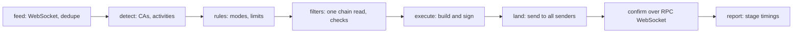

# Solana sniper bot for X/Twitter signals

This Solana sniper bot buys Solana and pump.fun tokens the moment a watched X account posts a contract address, changes its bio, follows someone, or when a pump.fun caller or FOMO user you track posts about a token. It runs on the [TweetStream](https://tweetstream.io/signup?offer=basic-monthly-trial&utm_source=github&utm_medium=referral&utm_campaign=solana-sniper-bot&utm_content=readme-intro) real-time feed.

It starts in dry run. Nothing is sent until you set `DRY_RUN=false` and give it a wallet.

## Try it in 2 minutes without a key

You need Node.js 22.18 or later.

```sh
git clone https://github.com/tweetstream-io/solana-sniper-bot.git
cd solana-sniper-bot/ts
npm install
npm run demo
```

The demo starts a local copy of the TweetStream WebSocket on your machine and replays a scripted session that touches every rule mode. The bot connects to it twice (an Ultra Speed key and a standard key, as you would run it in production), keeps the first copy of each event, builds and signs real pump.fun buy transactions with a throwaway key, and sends none of them. Chain reads are answered from the script, so nothing leaves your machine.

This is a trimmed run from our machine:

```text
connected ultra ws://127.0.0.1:38381/ws
connected standard ws://127.0.0.1:38381/ws
feed      step 1/17: ca_scanner: the dev posts a contract address
signal    text FmKE…3DDA from @demo_dev (tweet/content twitter:2110165008347299840)
fire      dev-ca: buy FmKE…3DDA, CA in post text
dry run   dev-ca: would send a signed 786-byte pump buy of FmKE…3DDA for 0.01 SOL (checks 0.8 ms, mcap $4800, liquidity $300)
feed      step 3/17: ca_scanner: tweet/meta for the image arrives
signal    ocr H6oB…ru29 from @demo_dev (tweet/meta twitter:2110165010071158784)
fire      dev-ca: buy H6oB…ru29, CA in image text
feed      step 6/17: engagement: the KOL retweets a dev post containing an exclude word
skip      kol-engagement: keyword_exclude_found, "scam" within scan depth 1
feed      step 10/17: follow: the whale follows an account; the payload has no bio
skip      whale-follow: bio_not_in_payload, follow of @demo_quiet: no target bio in the event, and this example does not look profiles up
feed      step 14/17: callout: a watched pump.fun caller calls a token; the safety check rejects it
fire      caller: buy AwCd…ro19, callout by demo_caller
skip      caller AwCd…ro19: mint_authority: the supply can still be increased
feed      step 17/17: exits: the dev deletes the launch post, so the position bought on it is sold
dry run   would sell FmKE…3DDA (post_deleted)
summary   first copy of an event came from ultra: 17 times
summary   receipt->decision: p50 0.37 ms, p95 2.255 ms, n=10
summary   decision->signed: p50 2.359 ms, p95 7.786 ms, n=9
next      Run it on live X data with a TweetStream key: https://tweetstream.io/signup?offer=basic-monthly-trial&utm_source=github&utm_medium=referral&utm_campaign=solana-sniper-bot&utm_content=cli-demo
```

The demo times each code path once, cold. `npm run bench` measures the same path warm; see [docs/latency.md](docs/latency.md).

## Run it on live X data

1. Get an API key. [Start a trial](https://tweetstream.io/signup?offer=basic-monthly-trial&utm_source=github&utm_medium=referral&utm_campaign=solana-sniper-bot&utm_content=readme-quickstart): the Minimum and Pro trials last 3 days with 5 tracked accounts and 1 WebSocket connection. Copy the key from the [dashboard](https://tweetstream.io/dashboard?tab=api&utm_source=github&utm_medium=referral&utm_campaign=solana-sniper-bot&utm_content=readme-quickstart), and add the accounts you want to watch there too.
2. In the repository root, copy the two example files:

   ```sh
   cp .env.example .env            # paste the key into TWEETSTREAM_API_KEY
   cp config.example.json config.json
   ```

3. In `config.json`, replace `YOUR_ACCOUNT` in the `dev-ca` rule with the X account to watch, and set `amountSol`. A numeric account id is safer than a handle, because handles can be renamed or taken over.
4. Start it from `ts/`:

   ```sh
   npm start
   ```

It prints every signal it sees and every buy it would make. When the logs look right and you have read [docs/safety.md](docs/safety.md), set `DRY_RUN=false` and `WALLET_SECRET_KEY` in `.env`. Use a wallet that holds only what you can lose; the example config stops spending at 0.5 SOL in total.

## How an event becomes a trade



To follow one event in the code, start at `Decider.handle` in `ts/src/pipeline.ts` (feed, dedupe, detection, rules), then `Trader.buy` in `ts/src/execute/trade.ts`, which calls the checks in `filters/gate.ts`, the pump.fun builder in `execute/pump.ts`, and the senders in `land/land.ts`. The trade state machine is `ts/src/execute/trades.ts`. [docs/how-it-works.md](docs/how-it-works.md) walks through them.

## Rule modes

Each rule in `config.json` has one mode. [docs/modes.md](docs/modes.md) has a minimal config for each, and [docs/config.md](docs/config.md) lists every field.

| Mode | Fires when | TweetStream event |
| --- | --- | --- |
| `ca_scanner` | a watched account posts a contract address: in text, a token link, an image, a quoted post, a pin, or a bio | `tweet/content`, `tweet/update`, `tweet/meta`, `tweet/pin`, `account/profile_update` |
| `engagement` | a watched account retweets, quotes, or replies to a target post or account | `tweet/content` |
| `new_tweet` | a watched account posts (optionally with a keyword) or changes its bio | `tweet/content`, `account/profile_update` |
| `follow` | a watched account follows or unfollows someone; can buy the CA in the followed account's bio | `account/follow`, `account/unfollow` |
| `pfp_update` | a watched account changes its avatar, banner, name, bio, or website | `account/profile_update` |
| `callout` | a pump.fun caller you track posts a callout | `account/callout`, `account/callout_update` |
| `fomo` | a FOMO user or coin you track gets a thesis, or the coin is first seen verified | `account/thesis`, `account/token_verified` |

X made likes private in 2024, so likes cannot be watched; engagement means retweets, quotes, and replies. Every plan includes pump.fun callouts and FOMO theses and verifications. Minimum covers 10 pump.fun accounts, 10 FOMO users, and 10 FOMO coins; Pro, Scale, and Ultra Speed cover 100 of each. Both are live only, with no history replay.

## Go faster: Ultra Speed

Every TweetStream plan works with this bot. For competitive sniping, where several bots race for the same launch, the order in which you receive a post matters most. Ultra Speed gives first-send priority to 10 to 100 X accounts you select, through a separate Ultra API key.

The setup we recommend: an Ultra key for the handful of accounts you actually snipe, and a standard key for the wider watchlist. Put the first in `TWEETSTREAM_ULTRA_API_KEY` and the second in `TWEETSTREAM_API_KEY`. The bot opens both connections and keeps whichever copy of an event arrives first.

[Start a 24-hour Ultra Speed trial](https://tweetstream.io/signup?intent=ultra_speed&ultraBilling=MONTHLY&utm_source=github&utm_medium=referral&utm_campaign=solana-sniper-bot&utm_content=readme-ultra), or see current measurements on the [speed check page](https://tweetstream.io/speedcheck?utm_source=github&utm_medium=referral&utm_campaign=solana-sniper-bot&utm_content=readme-ultra). Those figures time each post from its X timestamp to receipt on a TweetStream server; your network hop, the bot's own work, and trade execution come on top. Plans and prices are on the [pricing page](https://tweetstream.io/pricing?utm_source=github&utm_medium=referral&utm_campaign=solana-sniper-bot&utm_content=readme-ultra).

## Where the milliseconds go

| Stage | What costs time | What the bot does about it |
| --- | --- | --- |
| post to your machine | TweetStream's pipeline, then the network to you | run in Ashburn, Virginia next to `wss://ws-iad.tweetstream.io/ws`; WebSocket push, compression off, TCP_NODELAY |
| receipt to decision | parsing and matching | one JSON parse, synchronous detectors, a rule index built at startup, no network calls |
| decision to signed | the chain read and building the transaction | one `getMultipleAccounts` for the mint and its curve; pump.fun buys built locally; addresses derived while the read is in flight; blockhash and fee levels cached in the background; native Ed25519 signing |
| signed to accepted | network to your senders | the transaction is written to disk first; then, with `antiMev`, it goes to Jito with its tip, otherwise to every RPC and extra sender at once, with `skipPreflight` |
| accepted to confirmed | block inclusion | priority fee and Jito tip; rebroadcast until confirmed or expired; confirmation pushed over `signatureSubscribe` |

On our test machine the warm path from receipt to a signed transaction, without the chain read, takes about 0.5 ms. [docs/latency.md](docs/latency.md) has the numbers, how they were measured, and `npm run latency:probe` for measuring your own round trips.

## Safety

The bot checks each token in parallel under a time budget (150 ms by default). Off the pump.fun curve it rejects mints with a mint authority, a freeze authority, or risky Token-2022 extensions; on the curve those authorities are fixed by the program, so the bot skips those checks and saves the time. A check that fails or runs out of time counts as a failure. Spend caps that count fees and tips, one buy per mint, and a state file that records every transaction before it is sent limit the damage from a bad signal, also across crashes and restarts.

Sniping stays risky. Accounts get hijacked to post scam addresses, tokens get rugged minutes after launch, and a sniper that buys the top loses money. Read [docs/safety.md](docs/safety.md) before trading. This code is an example and is not financial advice.

## Repository layout

| Path | What it holds |
| --- | --- |
| `ts/` | the TypeScript bot, its tests, the demo feed, and the benchmark |
| `rust/` | the Rust version: the same config, state files, and fixtures ([rust/README.md](rust/README.md)) |
| `shared/` | the contract both bots follow: config schema, conformance fixtures, demo scenario ([shared/README.md](shared/README.md)) |
| `docs/` | how it works, modes, config, latency, safety |
| `config.example.json`, `.env.example` | starting points for your own `config.json` and `.env` |

## FAQ

### What is a Solana sniper bot?

A program that buys a token as early as possible after something happens: a launch, a listing, or a post. This one watches X/Twitter and the pump.fun and FOMO feeds through TweetStream and buys on Solana, mostly pump.fun memecoins.

### How does a Twitter sniper bot work?

It keeps a WebSocket open to a real-time feed of posts from accounts you choose. When a post arrives it looks for a contract address or another trigger you configured, checks the token, builds a swap transaction, and sends it. The race is decided by how early you get the post and how fast you turn it into a transaction that lands.

### Which TweetStream plan do I need?

Every plan works, including the trial. For competitive sniping add Ultra Speed for the accounts you snipe; see [Go faster: Ultra Speed](#go-faster-ultra-speed) and the [pricing page](https://tweetstream.io/pricing?utm_source=github&utm_medium=referral&utm_campaign=solana-sniper-bot&utm_content=readme-faq).

### Is it safe? Do I have to share my private key?

Your key never leaves your machine. The bot reads it from `.env`, signs locally, and sends the signed transaction to the RPC and Jito endpoints you configure. It runs in dry run until you change `DRY_RUN`. Trading memecoins is still risky; see [docs/safety.md](docs/safety.md).

### How fast is it?

TweetStream publishes its own measurements on the [speed check page](https://tweetstream.io/speedcheck?utm_source=github&utm_medium=referral&utm_campaign=solana-sniper-bot&utm_content=readme-faq); they time each post from its X timestamp to receipt on a TweetStream server. The numbers in [docs/latency.md](docs/latency.md) measure something else: the time this bot spends between receiving an event and having a signed transaction, on our test machine. Your network, RPC, and how fast the transaction lands add to both.

## License

MIT. Copyright TweetStream.
