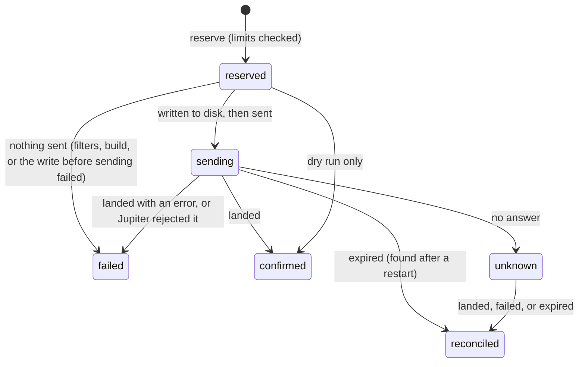

# Shared contract

The TypeScript bot (`ts/`) and the Rust bot (`rust/`) must behave the same way. The files in this folder are the contract between them; neither implementation keeps its own copy of what is defined here.

| File | What it defines |
| --- | --- |
| `config.schema.json` | the config format and every default |
| `addresses.json` | contract address extraction: patterns, the 32-byte rule, token link patterns, the denylist |
| `ledger.schema.json` | the trade state file (`state/live.json`, `state/dry-run.json`) |
| `fixtures/*.json` | event conformance cases: feed events in, signals and rule decisions out |
| `fixtures/config/*.json` | config conformance cases: defaults filled, errors reported |
| `demo/scenario.json`, `demo/config.json` | the scripted feed and config that `npm run demo` uses |

Sections: [Environment](#environment), [Config](#config), [Detection and matching](#detection-and-matching), [Signal JSON](#signal-json), [Decision JSON](#decision-json), [Trade state](#trade-state), [Event fixtures](#event-fixtures), [Demo feed](#demo-feed).

## Environment

Both bots read these from the environment, after loading `.env` in the repository root (values already in the environment win). Relative paths resolve against the repository root.

| Variable | Default | Meaning |
| --- | --- | --- |
| `TWEETSTREAM_API_KEY` | none | standard key; at least one of the two keys is required |
| `TWEETSTREAM_ULTRA_API_KEY` | none | Ultra Speed key; both connections run when both are set |
| `TWEETSTREAM_WS_URL` | `wss://ws-iad.tweetstream.io/ws` | feed endpoint |
| `DRY_RUN` | `true` | `true` or `false`; anything else is an error |
| `WALLET_SECRET_KEY` | none | base58, 64 bytes; required when `DRY_RUN=false` |
| `SOLANA_RPC_URLS` | `https://api.mainnet-beta.solana.com` | comma separated; the first serves reads |
| `SOLANA_WS_URL` | first RPC URL with `ws`/`wss` | signature subscriptions |
| `JITO_URL` | `https://ny.mainnet.block-engine.jito.wtf` | `off` disables Jito |
| `JUPITER_API_KEY` | none | sent as `x-api-key` |
| `SNIPER_CONFIG` | `config.json` | config path |
| `STATE_DIR` | `state` | holds `live.json` and `dry-run.json` |
| any `senders[].urlEnv` | none | an extra sender's URL; required when that sender is configured |

## Config

Defaults live only in `config.schema.json`. To apply them, walk the schema from the root. For every property missing from the config: if the property has a `default` (even `null`), insert a copy; otherwise if its `$ref` target has a `default`, insert that; otherwise if the target is an object with `properties`, insert `{}` and continue into it. Resolve `$ref` (always `#/$defs/<name>`) before reading `properties`. Walk into arrays through `items`. Validate against the schema after filling.

Then run the checks the schema cannot express, in this order:

1. Rule names are unique (error field `name` on the second rule with the name).
2. For each enabled rule, in order: `token.mint` and each `fomoCoins` entry, when not empty, decode from base58 to exactly 32 bytes (field `token.mint` or `fomoCoins.<i>`); then `reactor`, `accounts`, `reactedTo`, `targets`, `callers`, `fomoUsers`, in that order, contain no value matching `/^@?YOUR_/i` (field such as `accounts.0`). Disabled rules are not checked, so they may keep placeholders. `config.example.json` ships with a placeholder in its enabled rule on purpose: the bot refuses it until the user puts in a real account.
3. At least one rule is enabled (rule `null`, field `rules`).
4. Each `senders[i].tipAccounts[j]` decodes to 32 bytes (rule `null`, field `senders.<i>.tipAccounts.<j>`).

A config error carries `rule` (the rule's name, or `null` outside the rules) and `field` (the dot-separated path inside that rule, or inside the config when `rule` is `null`). For a schema error, the path is the innermost failing value; an unknown field is reported before any other schema error, as the path of the unknown key.

`fixtures/config/*.json` holds the cases:

```json
{ "name": "missing-mint", "description": "...", "config": { ... }, "expected": { "error": { "rule": "pfp", "field": "token.mint" } } }
{ "name": "defaults", "description": "...", "config": { ... }, "expected": { "values": { "rules.0.filters.maxSnipes": 1, "safety.budgetMs": 150 } } }
```

`values` paths are dot separated, with array indexes as numbers; each value must equal the filled config exactly.

## Detection and matching

Contract addresses, from `addresses.json`:

- A Solana candidate matches `solana.pattern` and decodes from base58 to exactly `decodedBytes` (32) bytes. An EVM candidate matches `evm.pattern` and is lowercased. Anything on `denylist` (compared after lowercasing EVM) is not an address.
- In free text, a candidate counts only when the characters directly before and after it are not in `standalone.wordChars`. Punctuation such as `CA:`, `$`, `(` and `.` around it is fine.
- Token links in free text match `linkInText` (case-insensitive); trailing `stripTrailing` characters are removed before parsing. A link (from the text or from a `urls[].url`) is parsed as a URL (prefixing `https://` when it has no scheme); the first entry of `links` whose `host` matches the lowercased hostname and whose `path` matches the path gives the mint from capture group 1, with that entry's `confidence`.
- Within one text, addresses are reported in order of first appearance (a link's position is where the link starts), one per address. When an address appears both inside a link and bare, the link's kind and confidence are used.

Keywords: a word matches when it appears without case (Unicode case folding) and the characters before and after it are not letters, digits, or `_` (or it is at the edge of the text). `scanDepth` 0 reads only the account's own text; depth n also reads n levels of referenced posts (level 1 is `ref`; level n+1 is each level-n post's `quoted` and `subtweet`; at most 4 levels in total).

Accounts:

- Post authors, follow and profile actors are X accounts (`namespace` `x`) when `platform` is absent or `twitter`; otherwise the namespace is the platform (`truth_social`, `binance_square`). Rule account specs only match namespace `x`: a numeric spec matches `id`, any other spec matches the handle without its leading `@` and without case.
- pump.fun callers match `callers` by username, FOMO authors match `fomoUsers` by id or username, both without case. FOMO coins match `fomoCoins` exactly.
- Profile baselines are kept per `(platform, id)`. A field's previous value is the event's `previous` value for that field when present, else the last value seen for that account, from earlier profile updates (`changes`) or post authors (`bio`, `name`, `handle`). The same baseline decides which fields changed (a field changed when its new value differs) and which addresses are new.

Which activities each mode listens to (the rest of a mode's behavior is in [docs/modes.md](../docs/modes.md)):

| Mode | Activities | Matched on |
| --- | --- | --- |
| `ca_scanner` | posts, profile updates, pins | `accounts` |
| `engagement` | posts | `reactor` |
| `new_tweet` | posts, profile updates | `accounts` |
| `follow` | follows and unfollows | `accounts` |
| `pfp_update` | profile updates | `accounts` |
| `callout` | callouts and callout updates | `callers` |
| `fomo` | theses and token verifications | `fomoUsers`, or the coin in `fomoCoins` |

Malformed payloads: an event whose payload lacks a field asyncapi.json marks required for that pair (for example `tweetId`, `author`, and `kind` on `tweet/content`; `eventId` on follows and profile updates; `caller.username`, `token.address`, and `calloutId` on callouts) produces no signals and no decisions, and does not stop later events.

## Signal JSON

One contract address found in one event.

```json
{ "event": "tweet/content twitter:2026541002650550272", "source": "text", "chain": "solana", "mint": "...", "confidence": "high", "actor": { "namespace": "x", "id": "111", "handle": "dev_one" } }
```

- `event`: `"<t>/<op> <key>"`. For `tweet/*` the key is `<platform>:<tweetId>`, with platform `d.platform`, else `d.author.platform`, else `twitter`. For other events it is `d.eventId`, else the envelope `id`, else an id from the payload: `<calloutId>:<kind or "callout">:<replyId or "">` for callouts, `thesis.id` for theses, `coin.address` for token verifications. Without any of these the key is empty.
- `source`: `text`, `url`, `meta`, `ocr`, `reference`, `pin`, `profile`, `follow_bio`, `callout`, `fomo`.
- `chain`: `solana` or `evm`.
- `confidence`: `text`, `pin`, `callout`, `fomo`: high. `url`: the link's confidence. `meta`: high when the token's `sources` include `text`, else medium. `ocr`, `reference`, `follow_bio`: medium. `profile`: high for `bio` and `websiteUrl`, medium for `name`, low when the field has no baseline.
- `actor`: `namespace` is `x`, `truth_social`, `binance_square`, `pump_fun`, `fomo`, or `none`; `id` and `handle` appear only when known. Handles lose their leading `@`. pump.fun callers have only `handle`. FOMO authors have `id` and `handle` (the username). `token_verified` has `{ "namespace": "none" }`.

Signals per event, in this order, one per address:

- posts (`tweet/content`, `tweet/update`, `tweet/meta`): addresses from `urls[].url`, then the text, then referenced posts level by level, then for a stored `tweet/meta`: `detected.tokens` in order (Solana addresses only), then `ocr.text`; an address already reported from the post is not repeated. A `tweet/meta` or `tweet/update` produces nothing until the post has an author with an id or handle; after that every post event reports the signals of the whole merged post.
- `tweet/pin`: `d.tweet.urls`, then `d.tweet.text` (or `d.text`).
- `account/profile_update`: addresses in `bio`, `name`, and `websiteUrl` of `changes` that were not in the baseline of the same field.
- `account/follow` and `account/unfollow`: addresses in the target's `bio`, then a token link in `websiteUrl`.
- `account/callout`, `account/callout_update`: `token.address`. `account/thesis`, `account/token_verified`: `coin.address`.

## Decision JSON

What each rule did with an event. A rule the event does not concern produces nothing.

```json
{ "event": "tweet/content twitter:...", "rule": "dev-ca", "decision": "fire", "mint": "...", "action": "buy", "source": "text" }
{ "event": "tweet/content twitter:...", "rule": "dev-ca", "decision": "skip", "code": "low_confidence" }
{ "event": "tweet/delete twitter:...", "decision": "exit", "mint": "...", "code": "post_deleted" }
{ "event": "account/thesis th-5", "rule": "fomo", "decision": "exit", "mint": "...", "code": "author_exited" }
```

- `fire`: `source` is the signal source that supplied the mint, or `null` when the rule names `token.mint`.
- `skip` codes: `stale_post`, `keyword_include_missing`, `keyword_exclude_found`, `no_contract_address`, `evm_not_supported`, `low_confidence`, `mint_not_in_bio`, `bio_not_in_payload`, `update_not_new`, `multiple_too_high`, `caller_not_holding`, `cooldown`, `max_snipes`.
- `stale_post`: when a post is older than `maxSignalAgeMs` at receipt, each rule whose matcher would have fired or skipped reports one `stale_post` instead. Rules the event does not concern stay silent.
- `exit` codes: `post_deleted` (no `rule` key) for a position or pending buy whose trigger post was deleted; `caller_exited` and `author_exited` for a position or pending buy that this rule opened because of that same caller or author (same namespace, and same id, or same handle without case when ids are missing).
- Order within one event: all `fire`, then all `skip`, then all `exit`. Within each group, rules in config order; within a rule, signals in signal order.
- A rule fires at most once per post (`engagement`, `new_tweet` on posts), per event (`follow`, `pfp_update`, `new_tweet` on bios), or per mint (`ca_scanner`, `callout`, `fomo`). A repeat is silent. A skip does not use up that chance.
- `maxSnipes` (0 = no limit) and `cooldownSec` count fires per rule. A fire that sends nothing is given back: the snipe and the fire-once key are released, exactly once (see Trade state).
- A repeated event produces nothing, whichever connection it came on: `tweet/update` and `tweet/meta` repeat by envelope `id` (never deduplicated without one); events with `d.eventId` repeat by that id; every other event repeats by its `event` key, and an event whose key is empty is never deduplicated.

## Trade state

Every buy and sell is a trade, recorded in `state/live.json` (or `state/dry-run.json` in dry run; the two never mix). The file follows `ledger.schema.json`, version 1. A bot validates it on load and refuses to start when it is unreadable, invalid, or of the other mode; only a missing file is created. Each write goes to a temp file, is flushed with fsync, renamed over the old file, and the directory is fsynced.



Reserving a buy checks, in this order: no other buy of the mint is in `reserved`, `sending`, or `unknown`; with `skipIfAlreadyBought`, the mint is not in `purchases`; with `skipIfAlreadyHolding`, there is no open position in it; and the largest possible debit fits the spend caps (per trade, per rolling hour, total). The largest possible debit is the amount plus the signature fee (5,000 lamports), the priority fee, every tip the transaction will carry, rent for a Token-2022 token account (2,074,080 lamports), and rent for pump.fun's volume accumulator (1,844,400 lamports). The part above the amount is `feeBudgetLamports`.

Reserving a sell fails when there is no position, or when the position's `sellTradeId` points to a sell still in `reserved`, `sending`, or `unknown`: one sell at a time.

Transitions:

- `reserved -> sending`: the signature, `lastValidBlockHeight`, signed bytes (`tx`), route, and sender names are written to disk before anything goes on the wire. If that write fails, nothing is sent and the trade fails.
- `-> failed` before sending: a buy's whole reservation is refunded; a sell clears `sellTradeId`.
- `-> confirmed` (or `reconciled` with `landed: true`): a buy settles spend to the actual debit when known (from the transaction's balance change), records the mint in `purchases`, and opens a position; exit intents recorded on it run now. A sell closes the position. `purchases` keeps the mint after the position is sold, so "already bought" covers exited mints.
- `-> failed` after sending (landed with an error): a buy settles spend to the actual debit, or to `feeBudgetLamports` when unknown, and is not a purchase. A sell clears `sellTradeId`.
- Jupiter `/execute` answers: code 0 is landed (its `signature` replaces ours); -1, -2, -3, -1002, -1003, -1004, -2002, -2003, -2004 are a rejection (failed, nothing debited); any other code, a timeout, or an unreadable answer is unknown.
- `-> unknown`: nothing is refunded or released, and the buy's mint goes into `purchases` (it may have landed).
- `-> reconciled`: at startup and every 2 seconds the reconciler checks each `sending` or `unknown` trade's signature (`getSignatureStatuses` with history). Confirmed without error: landed, and the position opens with an unknown token amount. Confirmed with an error: failed. Not found and the current block height is above `lastValidBlockHeight`: expired, which refunds a buy's reservation and removes it from `purchases`. Otherwise the stored `tx` is sent again to the same senders.
- At startup, a trade still `reserved` was never sent (because `sending` is written first) and fails with its reservation refunded.

Positions keep the trade's `trigger` (rule, fire key, event, post key, and the acting account), which is how delete, caller, and author exits find them. An exit for a mint whose buy is still pending is stored in that buy's `exitIntents` and applied when it lands; it is dropped if the buy never lands. A position's `tokenAmount` stays `null` until a balance read returns more than 0; a sell does not go out while the balance is unknown or 0.

Snipes and fires: the rule engine reserves a snipe when a rule fires. A fire is given back (snipe count minus one, fire-once key forgotten) exactly once, and only when no transaction of that fire was sent: the buy was refused or filtered, the build or the pre-send write failed, or a sell rule found no position. A dry-run trade counts as sent, so limits behave as they would live. A graduation retry (a pump.fun buy that failed on chain because the curve completed, retried once through Jupiter) is a new trade within the same fire and reserves no new snipe.

Where a transaction goes: with `antiMev`, only to Jito, and only when it carries the Jito tip; otherwise to every RPC, plus each extra sender that needs a tip only when the transaction carries that sender's tip. Jupiter trades go to Jupiter `/execute` alone.

## Event fixtures

```json
{
  "name": "engagement",
  "description": "What the case covers.",
  "config": { "rules": [ ... ] },
  "positions": [ { "mint": "...", "postKey": "twitter:123", "rule": "rule-name", "actor": { "namespace": "pump_fun", "handle": "CallerOne" } } ],
  "events": [ { "connection": "standard", "receivedAtMs": 1772000001100, "envelope": { "v": 1, "t": "tweet", "op": "content", "ts": 1772000001100, "d": { ... } } } ],
  "expectedSignals": [ ... ],
  "expectedDecisions": [ ... ]
}
```

- `config` is a config file as a user would write it; apply defaults before use. When absent, use any valid config with no rule that matches the events.
- `positions` are open positions held before the first event, each with the trigger it was bought on (`postKey` optional). They only matter for exits.
- `events` are fed in order to one fresh decision pipeline. `receivedAtMs` is the receipt time used for post age and cooldowns.
- `expectedSignals` and `expectedDecisions` are each optional. When present, the concatenation of every event's output, in event order, must equal the list exactly.
- Every expected value was written by hand from the protocol and the rules above, never produced by either implementation. To add a case, write a new file with one behavior per event, derive the output by hand, and run both test suites.

## Demo feed

`ts/scripts/demo-feed.ts` is a local stand-in for the TweetStream WebSocket that either bot can connect to:

```sh
cd ts
node scripts/demo-feed.ts --port 8787 --scenario ../shared/demo/scenario.json --clients 2 --speed 1
```

- `--port` (default 8787; 0 picks a free port), `--scenario` (default `shared/demo/scenario.json`), `--clients` (connections that must send `auth_ping` before the script starts; default 2), `--speed` (divides every `afterMs`; default 1). It listens on `ws://127.0.0.1:<port>/ws` and exits 1.5 s after the last step.
- Handshake: the client offers subprotocols `tweetstream.v1` and `tweetstream.auth.token.<key>`. The server selects `tweetstream.v1`, answers 400 without it and 401 for a key not in `keys`. Every `{"op":"auth_ping"}` gets a `control/auth_pong` envelope.

Scenario format:

```json
{
  "description": "...",
  "keys": { "standard": "demo-standard-key", "ultra": "demo-ultra-key" },
  "ultraLeadMs": 3,
  "chain": {
    "solUsd": 150, "priorityFeeMicroLamports": 40000, "tipFloorSol": 0.00002, "blockHeight": 300000000, "epoch": 850,
    "feeTiers": [ { "marketCapLamportsThreshold": "0", "protocolFeeBps": 95, "creatorFeeBps": 30 } ],
    "mints": { "<mint>": { "tokenProgram": "token-2022", "mintAuthority": false, "freezeAuthority": false, "supply": "1000000000000000", "decimals": 6, "curve": { "virtualTokenReserves": "...", "virtualQuoteReserves": "...", "realTokenReserves": "...", "realQuoteReserves": "...", "tokenTotalSupply": "...", "complete": false } } }
  },
  "steps": [ { "afterMs": 400, "to": "both", "note": "what this step shows", "envelope": { "v": 1, "t": "tweet", "op": "content", "ts": "{{now}}", "d": { ... } } } ]
}
```

- Each step waits `afterMs` after the previous one. `to` is `both`, `standard`, or `ultra`; `both` sends to the Ultra connection first and to the standard one `ultraLeadMs` later, so the bot must drop a duplicate.
- In envelopes, the string `"{{now}}"` becomes the current time in Unix ms (a number), and `{{tweet:<name>}}` inside a string becomes an X post id whose embedded publish time is when that name is first used. The same name maps to the same id within a run.
- `chain` is what the demo's stand-in network answers: for each mint, a mint account owned by SPL Token (`spl`) or Token-2022 with the given authorities, supply, and decimals; when `curve` is not null, a pump.fun bonding curve account; pump.fun's fee config with `feeTiers`; `blockHeight` and `epoch` from `getEpochInfo`, with each blockhash valid for 150 blocks. Amounts are decimal strings.
